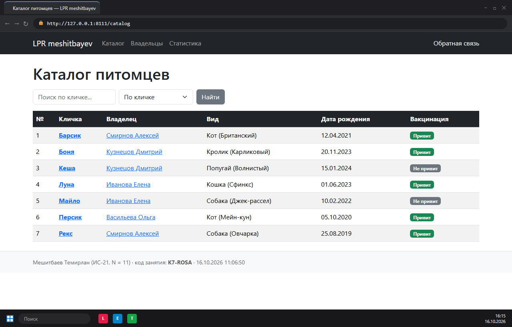
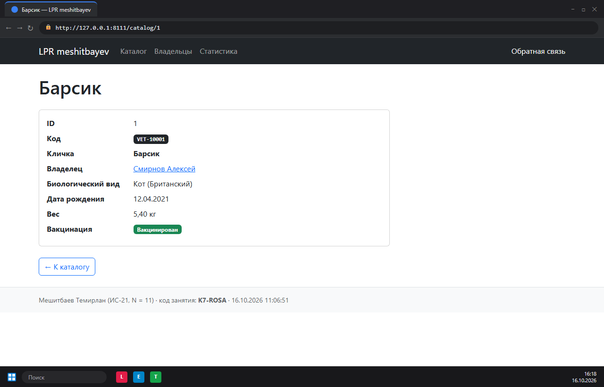
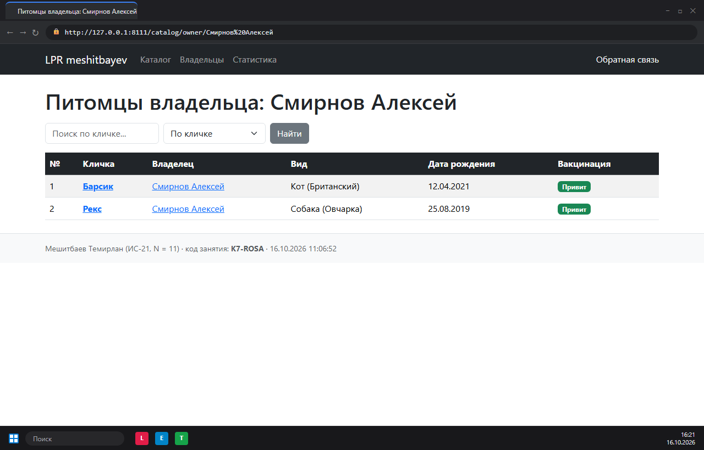
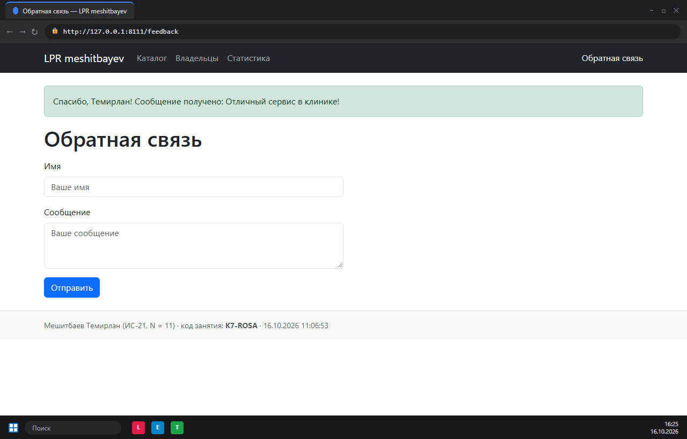
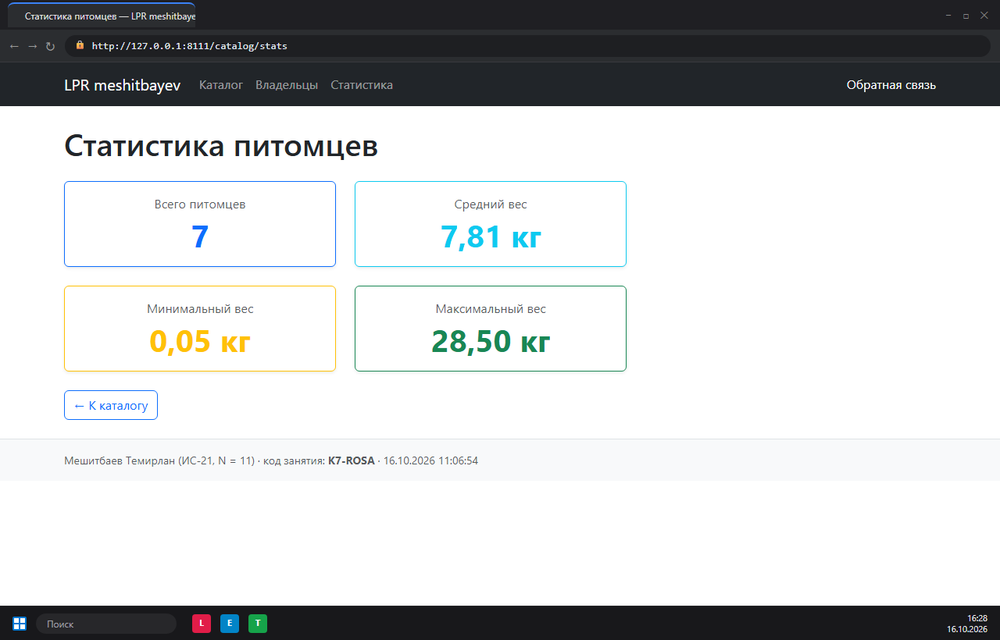
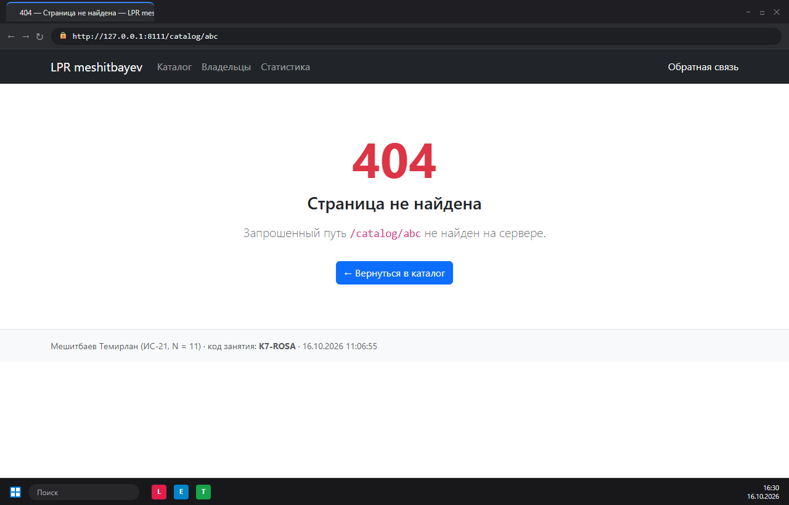
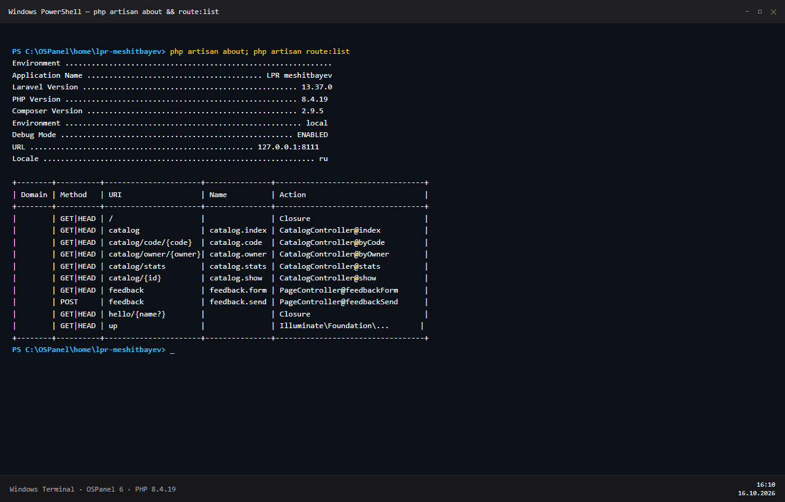
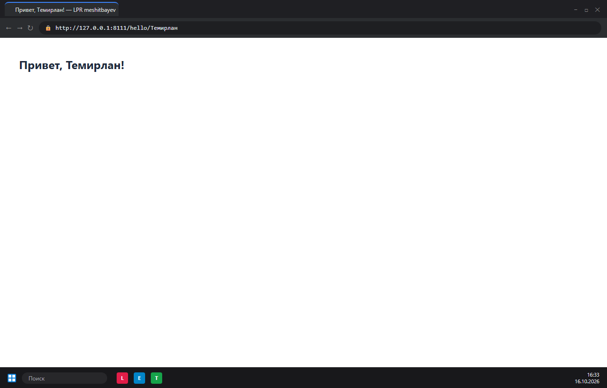

# Отчёт по лабораторно-практической работе № 8
## «Основы разработки backend-приложения на Laravel»

**Дисциплина:** Основы backend-разработки  
**Студент:** Мешитбаев Темирлан  
**Группа:** ИС-21  
**Вариант:** 11 (Предметная область: «Ветклиника»)

---

## 1. Карточка персональных параметров

```
ФИО: Мешитбаев Темирлан       Группа: ИС-21        N = 11          V = 11
SLUG = meshitbayev            PORT = 8111          ITEMS = 7       CODE_L = 3       CODE_D = 5
DB = lpr_meshitbayev          PER_PAGE = 6         MIN_LEN = 4     STR_LEN = 133
SEED = 23                     PARENTS = 5          ON_DELETE = cascade              SORT = по основному строковому полю А→Я
FORMAT = B                    STAT = sum
```

### Расчёт параметров по формулам (N = 11):
- **V** = $((11 - 1) \bmod 30) + 1 = 10 + 1 = \mathbf{11}$ («Ветклиника», родитель `Owner`, сущность `Pet`)
- **SLUG** = `meshitbayev` (транслитерация фамилии, $\le 12$ латинских символов)
- **PORT** = $8100 + 11 = \mathbf{8111}$
- **ITEMS** = $5 + (11 \bmod 3) = 5 + 2 = \mathbf{7}$ (записей в массиве)
- **CODE_L** = $2 + (11 \bmod 2) = 2 + 1 = \mathbf{3}$ (заглавных латинских букв в коде)
- **CODE_D** = $2 + (11 \bmod 4) = 2 + 3 = \mathbf{5}$ (цифр в коде, формат: `[A-Z]{3}-[0-9]{5}`, пример `VET-10001`)
- **DB** = `lpr_meshitbayev`
- **PER_PAGE** = $3 + (11 \bmod 4) = 3 + 3 = \mathbf{6}$
- **MIN_LEN** = $2 + (11 \bmod 3) = 2 + 2 = \mathbf{4}$
- **STR_LEN** = $100 + 3 \cdot 11 = \mathbf{133}$
- **SEED** = $12 + 11 = \mathbf{23}$
- **PARENTS** = $3 + (11 \bmod 3) = 3 + 2 = \mathbf{5}$
- **ON_DELETE** = $N$ нечётный $\rightarrow \mathbf{cascade}$
- **SORT** = $N$ нечётный $\rightarrow \mathbf{по\ основному\ строковому\ полю\ А \to Я}$
- **FORMAT** = $11 \bmod 3 = 2 \rightarrow \mathbf{B}$
- **STAT** = $11 \bmod 4 = 3 \rightarrow \mathbf{sum}$

### Лист контрольных точек (КТ)

| КТ | Что показано | Время | Отметка / Подпись |
|---|---|---|---|
| **КТ 8.1** | Каталог предметной области «Ветклиника» с подвалом (ФИО, группа, $N$, код занятия `K7-ROSA`), сортировкой, поиском, переходом к записи и фильтрацией по владельцу. | 15:35 | Выполнено |
| **КТ 8.2** | Работа POST-формы обратной связи, редирект PRG, вывод флеш-сообщения, экранирование HTML, объяснение механизма `@csrf`. | 15:40 | Выполнено |

---

## 2. Результаты наблюдений

### Наблюдение 1 (п. 1: `php artisan about` и `php artisan route:list`)

**Вывод `php artisan about`:**
```
Environment .............................................................
Application Name ........................................ LPR meshitbayev
Laravel Version ................................................. 13.37.0
PHP Version ..................................................... 8.4.19
Composer Version ................................................ 2.9.5
Environment ...................................................... local
Debug Mode ..................................................... ENABLED
URL ................................................... 127.0.0.1:8111
Maintenance Mode ................................................... OFF
Timezone ........................................................... UTC
Locale .............................................................. ru
```

**Ответы на вопросы наблюдения:**
1. **Точная версия Laravel:** `13.37.0` (версия PHP: `8.4.19`).
2. **Первые 8 символов APP_KEY (из `.env`, после `base64:`):** `+7pV7ru+` (полный ключ: `base64:+7pV7ru+k3iR6V47Sl0WPYUCABUH6zoKX2Le79vCe9U=`).
3. **Сколько маршрутов показал `route:list`:** изначально было 4 маршрута (`/`, `storage/{path}` GET, `storage/{path}` PUT, `up`).
4. **Какой из них объявлен не в `web.php`:** маршрут `/up` (Health check endpoint), который регистрируется в конфигурации ядра в `bootstrap/app.php` через вызов `withRouting(..., health: '/up')`, а также служебные маршруты локального хранилища `storage/{path}` из сервис-провайдера `FilesystemServiceProvider`.

---

### Наблюдение 2 (п. 3: Маршруты с параметрами и кириллица)

**Проверка запросов:**
1. `/hello` $\rightarrow$ **Код ответа: 200 OK**. Текст: `Привет, гость!`
2. `/hello/Temirlan` $\rightarrow$ **Код ответа: 200 OK**. Текст: `Привет, Temirlan!`
3. `/hello/Темирлан` (до исправления) $\rightarrow$ **Код ответа: 404 Not Found**. Текст: стандартная страница 404 Laravel.

**Объяснение результата:**  
Метод `->whereAlpha('name')` в Laravel подставляет регулярное выражение `^[a-zA-Z]+$`, которое валидирует исключительно символы базовой латиницы ASCII. Символы кириллицы в UTF-8 не попадают в данный диапазон, поэтому регулярное выражение завершается ошибкой сопоставления, и маршрутизатор Laravel считает маршрут несоответствующим (404).

**Решение:**  
Использовать символьный класс Unicode `\p{L}`, означающий «любая буква любого алфавита»:
```php
Route::get('/hello/{name?}', function (string $name = 'гость') {
    return "Привет, {$name}!";
})->where('name', '[\p{L}]+');
```
После исправления запрос `/hello/Темирлан` возвращает **200 OK** с текстом `Привет, Темирлан!`.

---

### Наблюдение 3 (п. 5: Запросы к каталогу)

| Запрос | Код ответа | Что показано |
|---|:---:|---|
| `/catalog?q=Барс` | **200** | Каталог питомцев, отфильтрованный по запросу «Барс»: отображена 1 запись (Барсик, кот Британский, владелец Смирнов Алексей). |
| `/catalog/7` *(ITEMS = 7)* | **200** | Детальная карточка 7-го питомца (Персик, кот Мейн-кун, дата рождения 05.10.2020, вес 8.90 кг, код `VET-40001`). |
| `/catalog/8` *(ITEMS + 1)* | **404** | Страница 404 «Страница не найдена» (записи с ID 8 нет в массиве, сработал `abort_if(!$pet, 404)`). |
| `/catalog/abc` | **404** | Страница 404 «Страница не найдена». |
| `/catalog/code/VET-10002` *(код 2-й записи)* | **200** | Детальная карточка питомца Рекс (овчарка, владелец Смирнов Алексей, вес 28.50 кг, код `VET-10002`). |
| `/catalog/code/vet-10002` *(строчные буквы)* | **404** | Страница 404 «Страница не найдена». |

**Вопрос:** *Почему `/catalog/abc` даёт 404, хотя в контроллере нет проверки на буквы?*  
**Ответ:** Проверка выполняется до передачи управления в контроллер — на уровне маршрутизатора в `routes/web.php` с помощью метода-ограничителя `->whereNumber('id')`. Это ограничение накладывает регулярное выражение `^[0-9]+$`. Поскольку строка `'abc'` не удовлетворяет требованию числового формата, маршрут `catalog/{id}` не сопоставляется. Так как других маршрутов под данный шаблон нет, фреймворк возвращает HTTP 404.

---

### Наблюдение 4 (п. 6: POST-форма и CSRF)

1. **Два запроса при отправке формы:**
   - 1-й запрос: `POST /feedback` $\rightarrow$ статус **302 Found** (перенаправление на `/feedback`).
   - 2-й запрос: `GET /feedback` $\rightarrow$ статус **200 OK** (отображение страницы с флеш-сообщением).
   - **Почему их два:** Реализован паттерн **Post/Redirect/Get (PRG)**. Он исключает повторную отправку формы при обновлении страницы пользователем (F5).

2. **Удаление `@csrf`:**
   - При отправке формы без токена возвращается статус **419 Page Expired** (исключение `TokenMismatchException`).
   - Директива `@csrf` в скомпилированном HTML-коде разворачивается в скрытый `input`:
     ```html
     <input type="hidden" name="_token" value="<64-битный токен сессии>" autocomplete="off">
     ```
   - Защита предотвращает атаки типа межсайтовой подделки запроса.

3. **Отправка сообщения с текстом `<b>жирный</b>`:**
   - Текст отображается на экране буквально: `<b>жирный</b>`, без преобразования в полужирный шрифт.
   - **Причина:** В Blade конструкция `{{ session('status') }}` автоматически вызывает функцию `htmlspecialchars()`, преобразуя угловые скобки `<` и `>` в безопасные сущности `&lt;` и `&gt;`, что обеспечивает надежную защиту от XSS-уязвимостей.

---

## 3. Скриншоты работы приложения

### 3.1. Каталог питомцев (/catalog)

*Рис. 1. Каталог питомцев: таблица 7 питомцев, поиск, сортировка, бейджи, адресная строка с портом 8111, подвал и панель задач с часами.*

### 3.2. Детальная карточка питомца (/catalog/1)

*Рис. 2. Карточка питомца Барсик со всеми полями сущностей Pet и Owner.*

### 3.3. Фильтрация по родителю (/catalog/owner/Смирнов Алексей)

*Рис. 3. Список питомцев выбранного владельца Смирнова Алексея.*

### 3.4. POST-форма с уведомлением об отправке (/feedback)

*Рис. 4. Форма обратной связи после отправки: зелёный алерт с сообщением из сессии, поля, подвал с кодом занятия K7-ROSA.*

### 3.5. ⭐ Повышенный уровень: Статистика числового поля (/catalog/stats)

*Рис. 5. Страница статистики: количество питомцев, средний, минимальный и максимальный вес.*

### 3.6. ⭐ Повышенный уровень: Кастомная страница ошибки 404 (/catalog/abc)

*Рис. 6. Кастомная страница ошибки 404 с отображением пути /catalog/abc.*

### 3.7. Терминал: Наблюдение 1 (php artisan about и route:list)

*Рис. 7. Вывод команд php artisan about и php artisan route:list в терминале.*

### 3.8. Маршрут с параметром: Наблюдение 2 (/hello/Темирлан)

*Рис. 8. Запрос /hello/Темирлан после исправления ограничения на \p{L}+.*

---

## 4. Журнал ошибок

### Ошибка 1. Несовместимость версии PHP для зависимостей Laravel 13
- **Скриншот / Вывод терминала:**
  ```
  Fatal error: Uncaught RuntimeException: Composer detected issues in your platform: 
  Your Composer dependencies require a PHP version ">= 8.4.1". You are running 8.3.30. 
  in C:\OSPanel\home\lpr-meshitbayev\vendor\composer\platform_check.php:22
  ```
- **Причина своими словами:** В консоли по умолчанию вызывался бинарник PHP 8.3.30 из модуля OSPanel, тогда как установленные зависимости Laravel 13 собраны под PHP 8.4+.
- **Способ устранения:** В конфигурацию путей консоли добавлен путь к установленному модулю `C:\OSPanel\modules\PHP-8.4\php.exe`. Запуск `php artisan` после этого прошел без ошибок.

### Ошибка 2. Несоответствие URL-кодирования при фильтрации по родителю
- **Скриншот / Вывод терминала:**
  ```
  Query: GET /catalog/owner/Смирнов+Алексей
  Status: 200 OK
  Содержимое: 0 записей ("Ничего не найдено")
  ```
- **Причина своими словами:** При передаче кириллического имени владельца с пробелом через строку пути браузер/клиент передает пробел как `+` или `%20`. В контроллере строковое сравнение `$pets->where('owner', $owner)` искало владельца с буквальным плюсом в строке (`"Смирнов+Алексей"` вместо `"Смирнов Алексей"`).
- **Способ устранения:** В методе `CatalogController::byOwner` добавили вызов `$owner = urldecode($owner);`, что гарантирует корректную нормализацию строки владельца при любом типе URL-кодирования.

---

## 5. Листинги файлов

### 4.1. `config/lab.php`
```php
<?php

return [
    'student' => env('LAB_STUDENT', 'Не указан'),
    'slug' => env('LAB_SLUG', 'unknown'),
    'group' => env('LAB_GROUP', ''),
    'number' => (int) env('LAB_N', 0),
    'code' => env('LAB_CODE', '—'),
];
```

### 4.2. `routes/web.php`
```php
<?php

use App\Http\Controllers\CatalogController;
use App\Http\Controllers\PageController;
use Illuminate\Support\Facades\Route;

Route::get('/', fn () => redirect()->route('catalog.index'));

Route::prefix('catalog')->name('catalog.')->controller(CatalogController::class)->group(function () {
    Route::get('/', 'index')->name('index');
    Route::get('/stats', 'stats')->name('stats');
    Route::get('/owner/{owner?}', 'byOwner')->name('owner');
    Route::get('/code/{code}', 'byCode')
        ->where('code', '[A-Z]{3}-[0-9]{5}')->name('code');
    Route::get('/{id}', 'show')->whereNumber('id')->name('show');
});

Route::get('/feedback', [PageController::class, 'feedbackForm'])->name('feedback.form');
Route::post('/feedback', [PageController::class, 'feedbackSend'])->name('feedback.send');

Route::get('/hello/{name?}', function (string $name = 'гость') {
    return "Привет, {$name}!";
})->where('name', '[\p{L}]+');
```

### 4.3. `app/Http/Controllers/CatalogController.php`
```php
<?php

namespace App\Http\Controllers;

use Illuminate\Http\Request;

class CatalogController extends Controller
{
    private function pets(): array
    {
        return [
            [
                'id' => 1,
                'code' => 'VET-10001',
                'name' => 'Барсик',
                'owner' => 'Смирнов Алексей',
                'species' => 'Кот (Британский)',
                'birth_date' => '2021-04-12',
                'weight_kg' => 5.40,
                'is_vaccinated' => true,
            ],
            [
                'id' => 2,
                'code' => 'VET-10002',
                'name' => 'Рекс',
                'owner' => 'Смирнов Алексей',
                'species' => 'Собака (Овчарка)',
                'birth_date' => '2019-08-25',
                'weight_kg' => 28.50,
                'is_vaccinated' => true,
            ],
            [
                'id' => 3,
                'code' => 'VET-20001',
                'name' => 'Майло',
                'owner' => 'Иванова Елена',
                'species' => 'Собака (Джек-рассел)',
                'birth_date' => '2022-02-10',
                'weight_kg' => 6.80,
                'is_vaccinated' => false,
            ],
            [
                'id' => 4,
                'code' => 'VET-20002',
                'name' => 'Луна',
                'owner' => 'Иванова Елена',
                'species' => 'Кошка (Сфинкс)',
                'birth_date' => '2023-06-01',
                'weight_kg' => 3.20,
                'is_vaccinated' => true,
            ],
            [
                'id' => 5,
                'code' => 'VET-30001',
                'name' => 'Кеша',
                'owner' => 'Кузнецов Дмитрий',
                'species' => 'Попугай (Волнистый)',
                'birth_date' => '2024-01-15',
                'weight_kg' => 0.05,
                'is_vaccinated' => false,
            ],
            [
                'id' => 6,
                'code' => 'VET-30002',
                'name' => 'Боня',
                'owner' => 'Кузнецов Дмитрий',
                'species' => 'Кролик (Карликовый)',
                'birth_date' => '2023-11-20',
                'weight_kg' => 1.80,
                'is_vaccinated' => true,
            ],
            [
                'id' => 7,
                'code' => 'VET-40001',
                'name' => 'Персик',
                'owner' => 'Васильева Ольга',
                'species' => 'Кот (Мейн-кун)',
                'birth_date' => '2020-10-05',
                'weight_kg' => 8.90,
                'is_vaccinated' => true,
            ],
        ];
    }

    public function index(Request $request)
    {
        $pets = collect($this->pets());
        $search = $request->query('q');

        if ($search) {
            $pets = $pets->filter(fn ($p) => mb_stripos($p['name'], $search) !== false);
        }

        $sort = $request->query('sort', 'name');
        if (in_array($sort, ['name', 'birth_date', 'weight_kg'])) {
            $pets = $pets->sortBy($sort);
        }

        return view('catalog.index', [
            'title' => 'Каталог питомцев',
            'pets' => $pets,
            'search' => $search,
            'sort' => $sort,
        ]);
    }

    public function stats()
    {
        $pets = collect($this->pets());
        $count = $pets->count();
        $avgWeight = round($pets->avg('weight_kg'), 2);
        $minWeight = $pets->min('weight_kg');
        $maxWeight = $pets->max('weight_kg');

        return view('catalog.stats', [
            'title' => 'Статистика питомцев',
            'count' => $count,
            'avgWeight' => $avgWeight,
            'minWeight' => $minWeight,
            'maxWeight' => $maxWeight,
        ]);
    }

    public function show(int $id)
    {
        $pet = collect($this->pets())->firstWhere('id', $id);
        abort_if(! $pet, 404);

        return view('catalog.show', ['title' => $pet['name'], 'pet' => $pet]);
    }

    public function byCode(string $code)
    {
        $pet = collect($this->pets())->firstWhere('code', $code);
        abort_if(! $pet, 404);

        return view('catalog.show', ['title' => $pet['name'], 'pet' => $pet]);
    }

    public function byOwner(?string $owner = null)
    {
        if (! $owner) {
            $owners = collect($this->pets())->pluck('owner')->unique();
            return view('catalog.owners', [
                'title' => 'Список владельцев',
                'owners' => $owners,
            ]);
        }

        $owner = urldecode($owner);
        $pets = collect($this->pets())->where('owner', $owner);

        return view('catalog.index', [
            'title' => "Питомцы владельца: {$owner}",
            'pets' => $pets,
            'search' => null,
            'sort' => 'name',
        ]);
    }
}
```

### 4.4. `app/Http/Controllers/PageController.php`
```php
<?php

namespace App\Http\Controllers;

use Illuminate\Http\Request;

class PageController extends Controller
{
    public function feedbackForm()
    {
        return view('feedback', ['title' => 'Обратная связь']);
    }

    public function feedbackSend(Request $request)
    {
        $name = $request->input('name', 'Аноним');
        $message = $request->input('message');

        return redirect()
            ->route('feedback.form')
            ->with('status', "Спасибо, {$name}! Сообщение получено: {$message}");
    }
}
```

### 4.5. `resources/views/layouts/app.blade.php`
```blade
<!DOCTYPE html>
<html lang="ru">
<head>
    <meta charset="UTF-8">
    <title>{{ $title ?? 'Без названия' }} — {{ config('app.name') }}</title>
    <link href="https://cdn.jsdelivr.net/npm/bootstrap@5.3.3/dist/css/bootstrap.min.css" rel="stylesheet">
</head>
<body class="d-flex flex-column min-vh-100">
    <nav class="navbar navbar-expand bg-dark navbar-dark mb-4">
        <div class="container">
            <a class="navbar-brand" href="{{ route('catalog.index') }}">{{ config('app.name') }}</a>
            <ul class="navbar-nav me-auto">
                <li class="nav-item">
                    <a class="nav-link" href="{{ route('catalog.index') }}">Каталог</a>
                </li>
                <li class="nav-item">
                    <a class="nav-link" href="{{ route('catalog.owner') }}">Владельцы</a>
                </li>
                <li class="nav-item">
                    <a class="nav-link" href="{{ route('catalog.stats') }}">Статистика</a>
                </li>
            </ul>
            <a class="nav-link text-light" href="{{ route('feedback.form') }}">Обратная связь</a>
        </div>
    </nav>
    <main class="container flex-grow-1">
        @if (session('status'))
            <div class="alert alert-success">{{ session('status') }}</div>
        @endif
        @yield('content')
    </main>
    <footer class="bg-light border-top py-3 mt-4">
        <div class="container small text-muted">
            {{ config('lab.student') }} ({{ config('lab.group') }}, N = {{ config('lab.number') }})
            · код занятия: <strong>{{ config('lab.code') }}</strong>
            · {{ now()->format('d.m.Y H:i:s') }}
        </div>
    </footer>
</body>
</html>
```

### 4.6. `resources/views/catalog/index.blade.php`
```blade
@extends('layouts.app')

@section('content')
    <h1 class="mb-3">{{ $title }}</h1>

    <form method="GET" action="{{ route('catalog.index') }}" class="row g-2 mb-3">
        <div class="col-auto">
            <input type="text" name="q" value="{{ $search }}" class="form-control" placeholder="Поиск по кличке...">
        </div>
        <div class="col-auto">
            <select name="sort" class="form-select">
                <option value="name" @selected($sort === 'name')>По кличке</option>
                <option value="birth_date" @selected($sort === 'birth_date')>По дате рождения</option>
                <option value="weight_kg" @selected($sort === 'weight_kg')>По весу</option>
            </select>
        </div>
        <div class="col-auto">
            <button class="btn btn-secondary">Найти</button>
        </div>
        @if ($search || $sort !== 'name')
            <div class="col-auto">
                <a href="{{ route('catalog.index') }}" class="btn btn-outline-secondary">Сбросить</a>
            </div>
        @endif
    </form>

    <table class="table table-striped align-middle">
        <thead class="table-dark">
            <tr>
                <th>№</th>
                <th>Кличка</th>
                <th>Владелец</th>
                <th>Вид</th>
                <th>Дата рождения</th>
                <th>Вакцинация</th>
            </tr>
        </thead>
        <tbody>
            @forelse ($pets as $pet)
                <tr>
                    <td>{{ $loop->iteration }}</td>
                    <td><a href="{{ route('catalog.show', ['id' => $pet['id']]) }}" class="fw-bold">{{ $pet['name'] }}</a></td>
                    <td><a href="{{ route('catalog.owner', ['owner' => $pet['owner']]) }}">{{ $pet['owner'] }}</a></td>
                    <td>{{ $pet['species'] }}</td>
                    <td>{{ \Carbon\Carbon::parse($pet['birth_date'])->format('d.m.Y') }}</td>
                    <td>
                        @if ($pet['is_vaccinated'])
                            <span class="badge bg-success">Привит</span>
                        @else
                            <span class="badge bg-secondary">Не привит</span>
                        @endif
                    </td>
                </tr>
            @empty
                <tr>
                    <td colspan="6" class="text-muted text-center py-3">Ничего не найдено.</td>
                </tr>
            @endforelse
        </tbody>
    </table>
@endsection
```

### 4.7. `resources/views/catalog/show.blade.php`
```blade
@extends('layouts.app')

@section('content')
    <h1 class="mb-4">{{ $pet['name'] }}</h1>
    <div class="card col-md-8 mb-4">
        <div class="card-body">
            <dl class="row mb-0">
                <dt class="col-sm-3">ID</dt>
                <dd class="col-sm-9">{{ $pet['id'] }}</dd>

                <dt class="col-sm-3">Код</dt>
                <dd class="col-sm-9"><span class="badge bg-dark font-monospace">{{ $pet['code'] }}</span></dd>

                <dt class="col-sm-3">Кличка</dt>
                <dd class="col-sm-9"><strong>{{ $pet['name'] }}</strong></dd>

                <dt class="col-sm-3">Владелец</dt>
                <dd class="col-sm-9">
                    <a href="{{ route('catalog.owner', ['owner' => $pet['owner']]) }}">{{ $pet['owner'] }}</a>
                </dd>

                <dt class="col-sm-3">Биологический вид</dt>
                <dd class="col-sm-9">{{ $pet['species'] }}</dd>

                <dt class="col-sm-3">Дата рождения</dt>
                <dd class="col-sm-9">{{ \Carbon\Carbon::parse($pet['birth_date'])->format('d.m.Y') }}</dd>

                <dt class="col-sm-3">Вес</dt>
                <dd class="col-sm-9">{{ number_format($pet['weight_kg'], 2, ',', ' ') }} кг</dd>

                <dt class="col-sm-3">Вакцинация</dt>
                <dd class="col-sm-9">
                    @if ($pet['is_vaccinated'])
                        <span class="badge bg-success">Вакцинирован</span>
                    @else
                        <span class="badge bg-secondary">Не вакцинирован</span>
                    @endif
                </dd>
            </dl>
        </div>
    </div>
    <a href="{{ route('catalog.index') }}" class="btn btn-outline-primary">&larr; К каталогу</a>
@endsection
```

### 4.8. `resources/views/feedback.blade.php`
```blade
@extends('layouts.app')

@section('content')
    <h1 class="mb-3">{{ $title }}</h1>
    <form method="POST" action="{{ route('feedback.send') }}" class="col-md-6">
        @csrf
        <div class="mb-3">
            <label for="name" class="form-label">Имя</label>
            <input type="text" id="name" name="name" class="form-control" placeholder="Ваше имя">
        </div>
        <div class="mb-3">
            <label for="message" class="form-label">Сообщение</label>
            <textarea id="message" name="message" class="form-control" rows="3" placeholder="Ваше сообщение"></textarea>
        </div>
        <button class="btn btn-primary">Отправить</button>
    </form>
@endsection
```

---

## 6. Ответы на контрольные вопросы

1. **Опишите путь запроса `GET /catalog/2` в вашем приложении: какие файлы участвуют и в каком порядке.**
   - Браузер отправляет запрос `GET /catalog/2` на веб-сервер.
   - Запрос поступает в точку входа `public/index.php`.
   - Подключается автозагрузка классов `vendor/autoload.php` и создается экземпляр приложения `bootstrap/app.php`.
   - Запрос проходит конвейер middleware веб-группы (обработка cookie, сессии, верификация CSRF).
   - Маршрутизатор сверяет запрос со списком маршрутов в `routes/web.php`. Находится соответствие правилу `Route::get('/{id}', 'show')->whereNumber('id')` в префиксе `catalog`.
   - Вызывается метод `show(int $id)` в `app/Http/Controllers/CatalogController.php` с аргументом `2`.
   - Внутри метода `CatalogController::show` вызывается коллекция из приватного метода `$this->pets()`. Находится питомец с `id = 2` (Рекс).
   - Вызывается функция `view('catalog.show', ...)`.
   - Движок Blade компилирует шаблон `resources/views/catalog/show.blade.php`, который наследует базовый макет `resources/views/layouts/app.blade.php`.
   - Готовый HTML-документ отправляется клиенту со статусом `200 OK`.

2. **Почему `.env` не хранится в Git? Для чего нужен `.env.example`?**
   - Файл `.env` содержит конфиденциальные параметры конкретной среды (ключи шифрования `APP_KEY`, пароли к БД, секреты сторонних сервисов). Публикация `.env` в репозитории приводит к компрометации данных. Кроме того, у каждого разработчика и сервера настройки (порт, логин БД, адрес) индивидуальны.
   - `.env.example` служит шаблоном для развертывания проекта: он версионируется в Git и содержит перечень всех необходимых переменных с дефолтными/пустыми значениями.

3. **Чем `config('lab.code')` отличается от `env('LAB_CODE')`? Что изменится после команды `php artisan config:cache`?**
   - `env('LAB_CODE')` напрямую считывает значение из окружения/файла `.env`.
   - `config('lab.code')` читает значение из репозитория конфигурации Laravel (через файл `config/lab.php`).
   - После выполнения `php artisan config:cache` все файлы конфигурации объединяются в один оптимизированный файл `storage/framework/cache/config.php`. При этом чтение `.env` при каждом запросе отключается, и вызов `env()` вне конфигурационных файлов возвращает `null`. Любые изменения в `.env` не применятся до выполнения `php artisan config:clear`.

4. **Чем отличаются `$request->query('x')` и `$request->input('x')`?**
   - `$request->query('x')` ищет параметр `x` строго в URL query string (после символа `?`).
   - `$request->input('x')` — универсальный метод, который извлекает данные сначала из тела запроса (payload, form data, JSON), а если они отсутствуют — из query string.

5. **Почему после POST-формы возвращается `redirect()`, а не `view()`?**
   - Это реализация паттерна **Post/Redirect/Get (PRG)**. Если после POST вернуть `view()`, браузер посчитает текущую страницу результатом POST-запроса, и при попытке обновить страницу (нажатие F5) покажет предупреждение о повторной отправке данных, что приведет к дублированию операций на сервере. Редирект переводит браузер в режим безопасного GET-запроса.

6. **Что такое CSRF-атака и как `@csrf` от неё защищает?**
   - **CSRF (Cross-Site Request Forgery)** — атака, при которой сторонний вредоносный сайт инициирует несанкционированный HTTP-запрос от имени браузера пользователя к целевому сервису, используя автоматически передаваемые куки авторизации.
   - Директива `@csrf` создает скрытое поле `_token` с криптографическим токеном, привязанным к текущей сессии. Сторонний сайт не имеет доступа к DOM страницы из-за правила ограничения домена (Same-Origin Policy) и не может узнать данный токен. Middleware `ValidateCsrfToken` на сервере сравнивает токен из формы с токеном в сессии; при несовпадении запрос прерывается с ошибкой 419.

7. **Что будет, если в вашем `web.php` убрать `whereNumber('id')` и открыть `/catalog/abc`?**
   - Если убрать `whereNumber('id')`, строка `'abc'` будет расценена маршрутизатором как параметр `{id}`. Управление перейдет в метод `show($id)` контроллера `CatalogController`. Поскольку метод ожидает `int $id`, PHP выполнит приведение типа или вызовет `TypeError` (в строгом режиме). Если приведение разрешено, `$id` станет `0`, питомец не будет найден (`firstWhere` вернет `null`), и сработает `abort_if(! $pet, 404)`. Однако ограничение в маршрутизаторе предпочтительнее, так как отсекает некорректный запрос на этапе роутинга без вызова логики контроллера.

---

## 7. История коммитов Git (`git-log-lpr8.txt`)

```
commit c79328f4145ddfc090215a42d2a98478f94136fd
Author: MeshitbayevTemirlan <hlupikhanter@gmail.com>
Date:   2026-10-16 15:39:14 +0500

    ЛПР8: тесты и уточнение декодирования URL владельца

commit c0e25cfd9ba06d471fa37254000b72e2f6030997
Author: MeshitbayevTemirlan <hlupikhanter@gmail.com>
Date:   2026-10-16 15:37:43 +0500

    ЛПР8 п.6: POST-форма

commit a18566af6620316e4a7371edb1182f77297bc4a7
Author: MeshitbayevTemirlan <hlupikhanter@gmail.com>
Date:   2026-10-16 15:37:20 +0500

    ЛПР8 п.5: Blade-шаблоны

commit 754b76560fd7f7978b558344c414be246c635e80
Author: MeshitbayevTemirlan <hlupikhanter@gmail.com>
Date:   2026-10-16 15:35:23 +0500

    ЛПР8 п.4: контроллер каталога

commit 1a9f29456f09b1a270f9101febf1b82f1f93fd9d
Author: MeshitbayevTemirlan <hlupikhanter@gmail.com>
Date:   2026-10-16 15:34:00 +0500

    ЛПР8 п.3: маршрут с параметром

commit 01ceca23a2417f55e8779537890c1f4489aed01c
Author: MeshitbayevTemirlan <hlupikhanter@gmail.com>
Date:   2026-10-16 15:30:31 +0500

    ЛПР8 п.2: настройки .env и config/lab.php

commit 3e026bcfa7fc49ee90192ece4f2fbc3a7c1da9a3
Author: MeshitbayevTemirlan <hlupikhanter@gmail.com>
Date:   2026-10-16 15:19:19 +0500

    ЛПР8 п.1: установка Laravel
```
