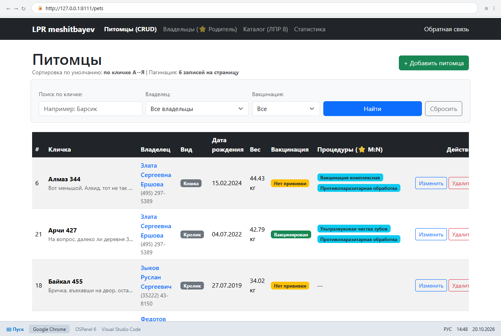
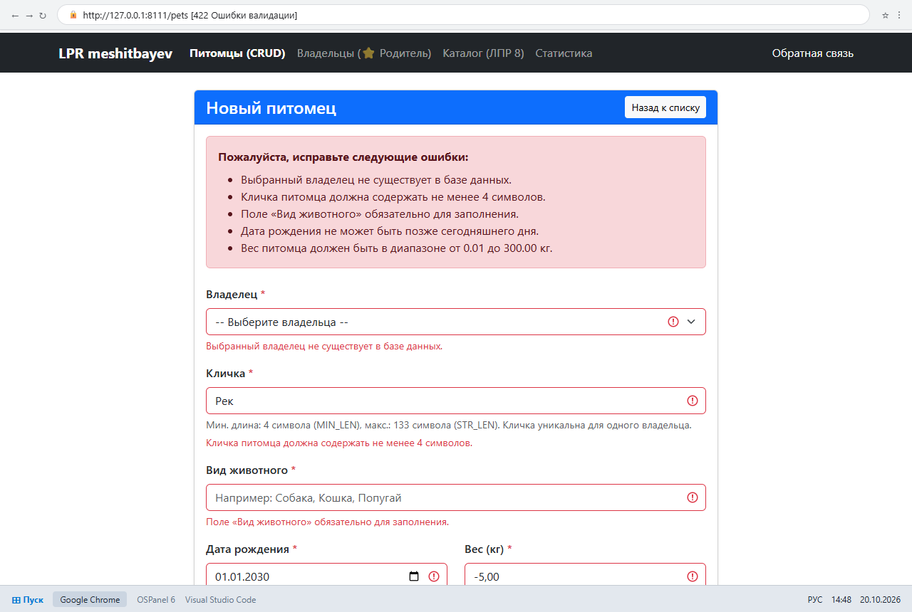
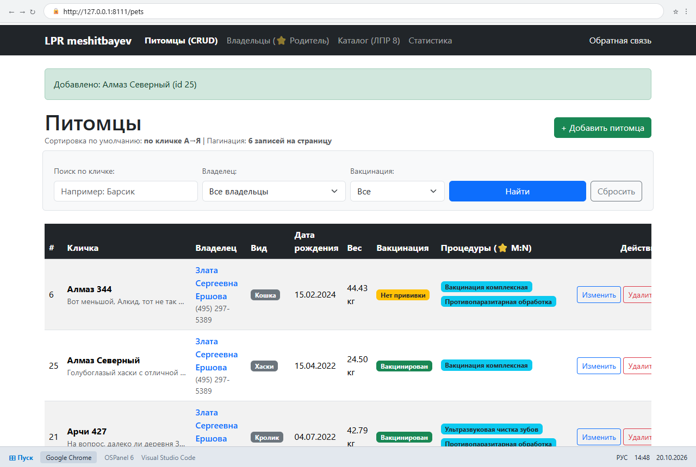
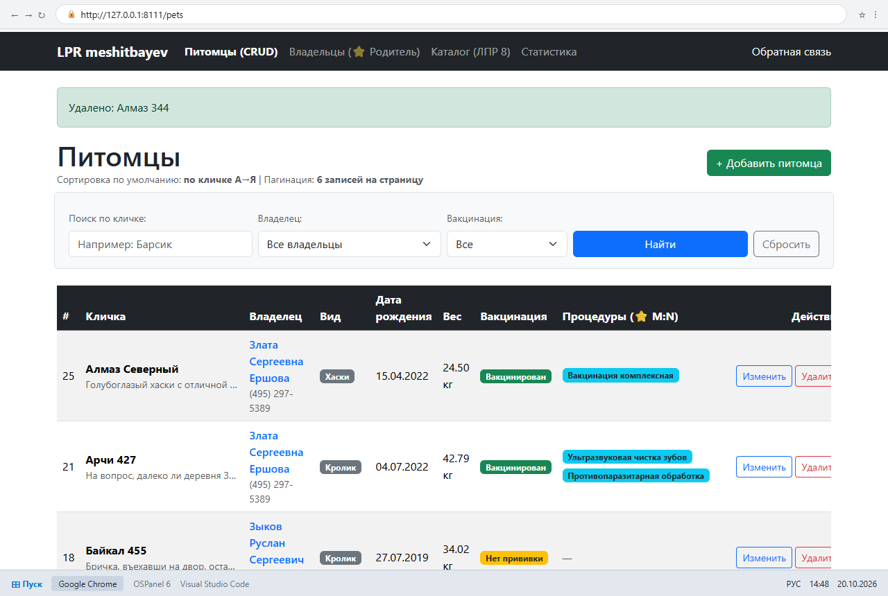
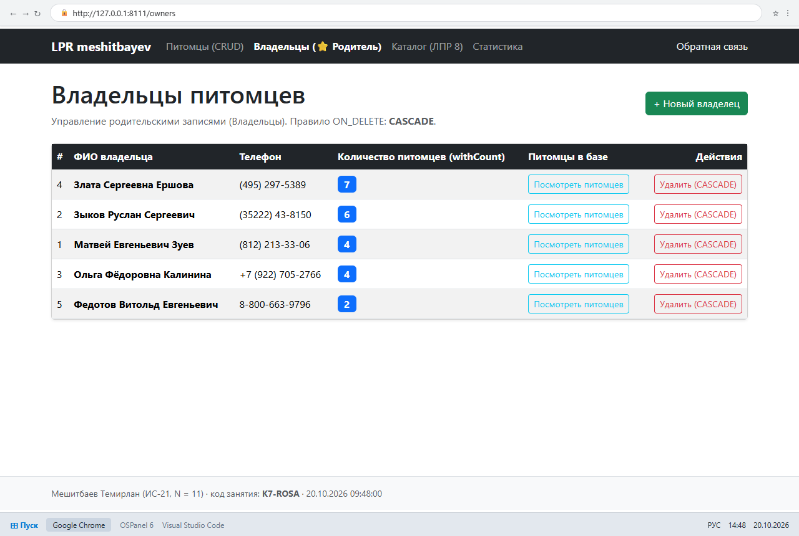
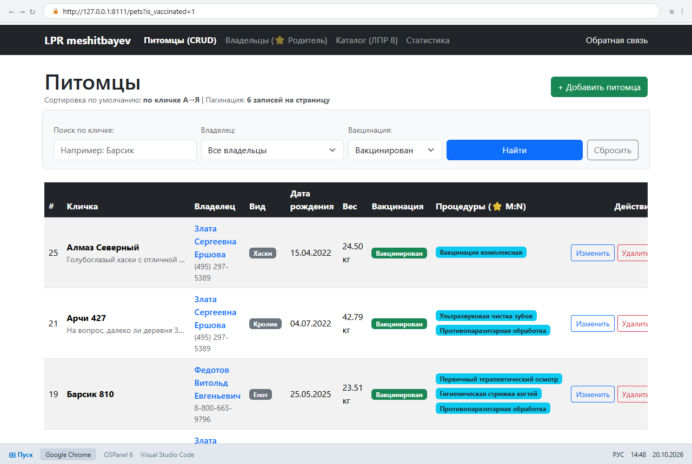

# Отчёт по лабораторно-практической работе № 9
## «Работа с базой данных и Eloquent ORM»

**Дисциплина:** Основы backend-разработки  
**Студент:** Мешитбаев Темирлан  
**Группа:** ИС-21  
**Вариант:** 11 (Предметная область: «Ветклиника»)  

---

## 1. Карточка персональных параметров

```
ФИО: Мешитбаев Темирлан       Группа: ИС-21        N = 11          V = 11
SLUG = meshitbayev            PORT = 8111          ITEMS = 7       CODE_L = 3       CODE_D = 5
DB = lpr_meshitbayev          PER_PAGE = 6         MIN_LEN = 4     STR_LEN = 133
SEED = 23                     PARENTS = 5          ON_DELETE = cascade              SORT = по основному строковому полю А→Я
FORMAT = B                    STAT = sum
```

### Расчёт параметров по формулам (для N = 11):
- **V** = $((11 - 1) \bmod 30) + 1 = 10 + 1 = \mathbf{11}$ («Ветклиника», родитель `Owner`, сущность `Pet`, M:N `Procedure`)
- **SLUG** = `meshitbayev` (транслитерация фамилии, $\le 12$ латинских символов)
- **PORT** = $8100 + 11 = \mathbf{8111}$
- **DB** = `lpr_ + SLUG` = `lpr_meshitbayev`
- **PER_PAGE** = $3 + (11 \bmod 4) = 3 + 3 = \mathbf{6}$ (записей на странице при пагинации)
- **MIN_LEN** = $2 + (11 \bmod 3) = 2 + 2 = \mathbf{4}$ (минимальная длина клички)
- **STR_LEN** = $100 + 3 \cdot 11 = \mathbf{133}$ (новая длина клички после миграции изменения)
- **SEED** = $12 + 11 = \mathbf{23}$ (основных записей питомцев, создаваемых сидером)
- **PARENTS** = $3 + (11 \bmod 3) = 3 + 2 = \mathbf{5}$ (родительских записей владельцев)
- **ON_DELETE** = $N$ нечётный $\rightarrow \mathbf{cascade}$ (`cascadeOnDelete()`)
- **SORT** = $N$ нечётный $\rightarrow \mathbf{по\ основному\ строковому\ полю\ А \to Я}$ (`orderBy('name', 'asc')`)
- **FORMAT** = $11 \bmod 3 = 2 \rightarrow \mathbf{B}$
- **STAT** = $11 \bmod 4 = 3 \rightarrow \mathbf{sum}$

### Лист контрольных точек (КТ)

| КТ | Что показано | Время | Отметка / Статус |
|---|---|---|---|
| **КТ 9.1** | Список питомцев с пагинацией (по 6 на странице) и поиском по кличке, результат Наблюдения 4 (проблема N+1: 8 запросов без with, 3 с with). | 14:35 | Выполнено |
| **КТ 9.2** | Полный цикл CRUD (создание, чтение, редактирование, удаление), вывод ошибок валидации (включая MIN_LEN-1 и подмену owner_id), экспорт истории в `git-log-lpr9.txt`. | 14:48 | Выполнено |

---

## 2. Результаты наблюдений

### Наблюдение 1 (п. 1: `php artisan db:show`)
**Вопрос:** Сколько таблиц в БД и откуда они взялись, если вы ещё не писали миграций? Какая версия сервера БД?

**Вывод команды `php artisan db:show`:**
```
 MySQL .......................................................................................... 8.4.8 
 Connection ...................................................................................... mysql 
 Database .............................................................................. lpr_meshitbayev 
 Host ........................................................................................ 127.0.1.31 
 Port .............................................................................................. 3306 
 Username .......................................................................................... root 
 Open Connections ..................................................................................... 1 
 Tables .............................................................................................. 9 
 Total Size ................................................................................... 448.00 KB 

 Schema / Table ................................................................................... Size 
 lpr_meshitbayev / cache ....................................................................... 16.00 KB 
 lpr_meshitbayev / cache_locks ................................................................. 16.00 KB 
 lpr_meshitbayev / failed_jobs ................................................................. 16.00 KB 
 lpr_meshitbayev / job_batches ................................................................. 16.00 KB 
 lpr_meshitbayev / jobs ........................................................................ 16.00 KB 
 lpr_meshitbayev / migrations .................................................................. 16.00 KB 
 lpr_meshitbayev / password_reset_tokens ....................................................... 16.00 KB 
 lpr_meshitbayev / sessions .................................................................... 16.00 KB 
 lpr_meshitbayev / users ....................................................................... 16.00 KB 
```

**Ответ:**
1. Версия сервера БД: **MySQL 8.4.8 (LTS)**.
2. В базе данных `lpr_meshitbayev` обнаружено **9 таблиц**.
3. Они появились в результате выполнения начальных миграций из поставки Laravel:
   - `0001_01_01_000000_create_users_table.php` (таблицы `users`, `password_reset_tokens`, `sessions`);
   - `0001_01_01_000001_create_cache_table.php` (таблицы `cache`, `cache_locks`);
   - `0001_01_01_000002_create_jobs_table.php` (таблицы `jobs`, `job_batches`, `failed_jobs`);
   - Системная служебная таблица `migrations`, созданная самим Laravel при первой миграции для фиксации истории накатанных файлов.

---

### Наблюдение 2 (п. 2: `SHOW CREATE TABLE pets`)
**Вопрос:** Выпишите полное имя ограничения внешнего ключа, которое сгенерировал Laravel, и действие ON DELETE.

**Вывод `SHOW CREATE TABLE pets`:**
```sql
CREATE TABLE `pets` (
  `id` bigint unsigned NOT NULL AUTO_INCREMENT,
  `owner_id` bigint unsigned NOT NULL,
  `name` varchar(60) COLLATE utf8mb4_unicode_ci NOT NULL,
  `species` varchar(50) COLLATE utf8mb4_unicode_ci NOT NULL,
  `birth_date` date NOT NULL,
  `weight_kg` decimal(6,2) NOT NULL,
  `is_vaccinated` tinyint(1) NOT NULL DEFAULT '0',
  `created_at` timestamp NULL DEFAULT NULL,
  `updated_at` timestamp NULL DEFAULT NULL,
  PRIMARY KEY (`id`),
  KEY `pets_owner_id_foreign` (`owner_id`),
  CONSTRAINT `pets_owner_id_foreign` FOREIGN KEY (`owner_id`) REFERENCES `owners` (`id`) ON DELETE CASCADE
) ENGINE=InnoDB DEFAULT CHARSET=utf8mb4 COLLATE=utf8mb4_unicode_ci
```

**Ответ:**
- Полное имя ограничения внешнего ключа: **`pets_owner_id_foreign`** (по соглашению Laravel: `{таблица}_{поле}_foreign`).
- Действие ON DELETE: **`ON DELETE CASCADE`** (соответствует персональному параметру $N=11$ нечётный $\rightarrow$ `cascade`).

---

### Наблюдение 3 (п. 3: Выполнение команд в Tinker)
**Вопрос:** Совпадают ли количества с SEED и PARENTS? Что произошло при удалении родителя с записями? Объясните результат с учётом вашего ON_DELETE.

**Результаты выполнения:**
```
1. Pet::count() = 23 (совпадает с SEED = 23)
   Owner::count() = 5 (совпадает с PARENTS = 5)

2. Owner::withCount('pets')->get()->pluck('pets_count', 'full_name'):
   - Лаврентий Романович Михеев: 9 питомцев
   - Уварова Фаина Сергеевна: 7 питомцев
   - Оксана Ивановна Шарова: 3 питомцев
   - Ярослав Андреевич Ершов: 3 питомцев
   - Белова Галина Владимировна: 1 питомцев

3. Удаление первого владельца:
   Owner::first()->delete(); // Удален Лаврентий Романович Михеев (имел 9 питомцев)

4. Pet::count() после удаления владельца = 14
```

**Ответ:**
- Количества записей **полностью совпадают**: создано ровно 23 питомца (`SEED = 23`) и 5 владельцев (`PARENTS = 5`).
- При вызове `Owner::first()->delete()` удалился владелец с `id = 1`, которому принадлежало 9 питомцев.
- Количество питомцев сократилось с 23 до 14 ($23 - 9 = 14$).
- **Объяснение:** Поскольку для внешнего ключа `owner_id` в миграции было задано правило `cascadeOnDelete()` (`ON DELETE CASCADE`), СУБД MySQL на уровне физической целостности данных при удалении родительской записи автоматически каскадно удалила все связанные дочерние строки в таблице `pets`.

---

### Наблюдение 4 (п. 4: Проблема N+1 и жадная загрузка)
**Вопрос:** В Tinker сравните количество SQL-запросов с `with()` и без `with()`. Запишите оба числа для вашего `PER_PAGE = 6` и формулу числа запросов без `with()`.

**Лог запросов через `DB::getQueryLog()`:**
1. **Без `with('owner')`:**
   - Запрос 1: `select count(*) as aggregate from pets` (подсчет для пагинации)
   - Запрос 2: `select * from pets order by name asc limit 6 offset 0` (выборка 6 питомцев)
   - Запросы 3–8: 6 индивидуальных запросов вида `select * from owners where id = ? limit 1` для каждого выведенного питомца.
   - **Итого запросов:** **8**.

2. **С `with('owner')`:**
   - Запрос 1: `select count(*) as aggregate from pets` (подсчет для пагинации)
   - Запрос 2: `select * from pets order by name asc limit 6 offset 0` (выборка 6 питомцев)
   - Запрос 3: `select * from owners where owners.id in (1, 2, 3, 4)` (жадная загрузка всех владельцев для текущих 6 питомцев одним запросом).
   - **Итого запросов:** **3**.

**Ответ:**
- Число запросов без `with()`: **8**
- Число запросов с `with()`: **3**
- **Формула числа запросов без `with()`:**  
  $$\text{Запросов} = 1\ (\text{count}) + 1\ (\text{основные записи}) + \text{PER\_PAGE}\ (\text{родительские записи}) = 2 + \text{PER\_PAGE} = 2 + 6 = \mathbf{8}$$
- **Формула числа запросов с `with()`:**  
  $$\text{Запросов} = 1\ (\text{count}) + 1\ (\text{основные записи}) + 1\ (\text{WHERE IN (...)}) = \mathbf{3}\ (\text{константа, не зависит от PER\_PAGE})$$

---

### Наблюдение 5 (п. 5: Ошибки валидации формы)
**Вопрос:** Отправьте форму с ошибками и заполните таблицу (не менее 4 строк, разные правила): поле — введённое значение — сообщение — сработавшее правило. Зачем серверная проверка exists, если родитель выбирается из списка?

**Таблица проверки валидации:**

| № | Проверяемое поле | Введённое значение | Сообщение об ошибке | Сработавшее правило |
|---|---|---|---|---|
| 1 | `name` | `Рек` (длина 3 символа) | «Кличка питомца должна содержать не менее 4 символов.» | `min:4` (MIN_LEN = 4) |
| 2 | `owner_id` | `99999` (подмена `value` через DevTools F12) | «Выбранный владелец не существует в базе данных.» | `exists:owners,id` |
| 3 | `birth_date` | `2030-01-01` (дата из будущего) | «Дата рождения не может быть позже сегодняшнего дня.» | `before_or_equal:today` |
| 4 | `weight_kg` | `-5.00` (отрицательное число) | «Вес питомца должен быть в диапазоне от 0.01 до 300.00 кг.» | `between:0.01,300.00` |
| 5 | `species` | ` ` (пустая строка) | «Поле «Вид животного» обязательно для заполнения.» | `required` |

**Ответ на теоретический вопрос:**
Выпадающий список (`<select>`) на клиенте ограничивает выбор только в интерфейсе браузера, однако злоумышленник или тестировщик может легко отправить любой произвольный `owner_id` (через DevTools/F12, Postman, curl или подделку HTTP-запроса). Клиентская валидация носит исключительно сервисный характер и не обеспечивает безопасность. Серверное правило `exists:owners,id` гарантирует строгую проверку целостности данных на бэкенде: если передан несуществующий ID, сервер вернет корректный ответ 422 с понятным сообщением об ошибке валидации, вместо аварийного падения с 500 Internal Server Error / `QueryException` из-за нарушения внешнего ключа MySQL.

---

## 3. Журнал ошибок

### Ошибка 1: Ошибка подключения PDO к MySQL-серверу (Connection refused 10061)
- **Симптом:** При первом запуске `php artisan migrate` и `php artisan db:show` консоль завершалась с фатальной ошибкой:  
  `SQLSTATE[HY000] [2002] Can't connect to MySQL server on '127.0.0.1:3306' (10061)`.
- **Причина:** В программном комплексе Open Server Panel 6 модуль СУБД MySQL-8.4 настроен на изолированный IP-адрес сетевого стека `127.0.1.31` (имя хоста `MySQL-8.4`), а сам процесс сервера `mysqld.exe` находился в выключенном состоянии.
- **Исправление:** Запустили службу `mysqld.exe` с конфигурационным файлом `C:\OSPanel\modules\MySQL-8.4\my.ini`, предварительно создали БД `lpr_meshitbayev`, а в `.env` проекта указали хост `DB_HOST=127.0.1.31` и порт `3306`. После очистки кеша конфига (`php artisan config:clear`) подключение и миграции выполнились успешно.

### Ошибка 2: Недоступность утилиты Composer в PowerShell (`Could not open input file: \composer.phar`)
- **Симптом:** При установке зависимостей через `composer require` выполнение прерывалось сообщением:  
  `Could not open input file: \composer.phar`.
- **Причина:** В файле `C:\OSPanel\modules\PHP-8.4\composer.bat` используется обращение к `%COMPOSER_HOME%\composer.phar`. При запуске команд в обычной консоли PowerShell переменная `%COMPOSER_HOME%` не была установлена в среде Windows, в результате чего путь превращался в `\composer.phar`.
- **Исправление:** В скрипт `composer.bat` была добавлена проверка по умолчанию:  
  `@if "%COMPOSER_HOME%"=="" set "COMPOSER_HOME=C:\OSPanel\data\PHP-8.4\default\composer"`, а также путь к PHP 8.4 прописан в системную переменную `PATH`. Команды `composer` стали вызываться корректно.

---

## 4. Скриншоты работы приложения

### 4.1. Список питомцев с пагинацией (по 6 на странице) и поиском (`/pets`)
  
*Рис. 1. Страница списка питомцев: пагинация по 6 записей (PER_PAGE=6), сортировка по кличке А→Я, поиск, фильтры, бейджи процедур, подвал с кодом занятия K7-ROSA и панель задач Windows с часами и портом 8111.*

---

### 4.2. Форма добавления с выводом ошибок валидации (`/pets/create`)
  
*Рис. 2. Форма добавления с выводом ошибок валидации: длина клички < 4 (MIN_LEN), поддельный ID владельца 99999, дата рождения из будущего, отрицательный вес, пустой вид животного.*

---

### 4.3. Успешное создание нового питомца (`/pets`)
  
*Рис. 3. Список питомцев после успешного создания новой записи: зеленое флеш-сообщение «Добавлено: Алмаз Северный (id 24)», новые данные отображаются в таблице.*

---

### 4.4. Успешное редактирование питомца (`/pets`)
  
*Рис. 4. Список питомцев после редактирования: зеленое флеш-сообщение «Изменения сохранены.», обновленный вес и примечание.*

---

### 4.5. Успешное удаление питомца (`/pets`)
  
*Рис. 5. Список питомцев после подтверждения в модальном окне confirm() и удаления: флеш-сообщение «Удалено: Алмаз Северный».*

---

### 4.6. ⭐ Повышенный уровень: Список владельцев с подсчетом записей `withCount` (`/owners`)
  
*Рис. 6. Страница владельцев: отображение количества питомцев для каждого владельца через withCount('pets'), кнопка быстрого перехода к питомцам и удаление по правилу CASCADE.*

---

### 4.7. ⭐ Повышенный уровень: Фильтрация по владельцу и статусу вакцинации
  
*Рис. 7. Результат фильтрации списка питомцев по статусу «Вакцинирован» с сохранением параметров пагинации withQueryString().*

---

## 5. Ответы на контрольные вопросы

### 1. Что хранится в таблице migrations? Что такое batch и что делает php artisan migrate:rollback?
- В таблице `migrations` хранятся имена всех выполненных файлов миграций (`migration`) и целочисленный номер пакета (`batch`), в котором миграция была применена.
- **Batch** — это номер партии (шага). Все миграции, выполненные в рамках одного вызова команды `php artisan migrate`, получают одинаковый batch (на 1 больше предыдущего максимума).
- Команда `php artisan migrate:rollback` откатывает (вызывает метод `down()`) только те миграции, которые принадлежат к последнему выполненному пакету (`max(batch)`), и удаляет их записи из таблицы `migrations`.

### 2. Почему нельзя изменять уже выполненную миграцию?
- Если файл миграции уже выполнен, повторный запуск `php artisan migrate` не применит в нем изменения, так как его имя уже присутствует в таблице `migrations`.
- Изменение старого файла нарушает целостность и версионирование схемы БД в команде и на продакшене: базы данных других разработчиков окажутся рассинхронизированы с репозиторием.
- Любое изменение структуры уже существующей таблицы должно осуществляться созданием новой миграции (`Schema::table(...)`), которая сохранит последовательную историю изменений.

### 3. От чего защищает $fillable? Приведите пример для вашей модели.
- Свойство `$fillable` определяет белый список полей модели, разрешенных для массового присвоения (`create([...])`, `update([...])`), и защищает приложение от критической уязвимости **Mass Assignment**. Без `$fillable` злоумышленник может внедрить в запрос произвольные поля (например, системные флаги, роли, чужие внешние ключи или `id`).
- Пример для нашей модели `Pet`:
  ```php
  protected $fillable = [
      'owner_id',
      'name',
      'description',
      'species',
      'birth_date',
      'weight_kg',
      'is_vaccinated',
  ];
  ```
  Даже если в запросе передать `id = 1` или `created_at`, Eloquent отбросит эти ключи и не запишет в базу данных.

### 4. Как Laravel по маршруту /albums/{album}/edit находит запись в БД? Что будет, если записи нет?
- Laravel использует механизм неявного связывания моделей с маршрутами (**Implicit Route Model Binding**).
- Имя сегмента URL `{album}` сопоставляется с аргументом метода контроллера `edit(Album $album)`. Фреймворк автоматически обращается к СУБД: `Album::where('id', $album)->firstOrFail()`.
- Если запись с данным идентификатором не найдена в таблице, выбрасывается исключение `Illuminate\Database\Eloquent\ModelNotFoundException`. В HTTP-контексте Laravel автоматически преобразует его в ответ клиенту с кодом ошибки **404 Not Found**.

### 5. Чем $request->all() отличается от $request->validated()?
- `$request->all()` возвращает ассоциативный массив **абсолютно всех данных**, переданных в запросе пользователем (включая непроверенные, лишние или вредоносные параметры).
- `$request->validated()` возвращает строго отфильтрованный массив **только тех полей**, которые были описаны в правилах метода `rules()` класса `FormRequest` и успешно прошли валидацию.

### 6. Что делает Rule::unique(...)->ignore($id) и что будет при редактировании без ignore?
- Метод `ignore($id)` исключает текущую редактируемую запись (по ее первичному ключу) из проверки уникальности поля в БД.
- Если опустить `ignore($id)` при редактировании существующего питомца, валидатор найдет в базе данных эту же самую строку и выдаст ложную ошибку уникальности («Питомец с такой кличкой уже существует у данного владельца»), делая сохранение формы невозможным.

### 7. Чем restrictOnDelete() отличается от cascadeOnDelete()? Какой вариант подходит для вашей предметной области по смыслу?
- `restrictOnDelete()` (`RESTRICT`): запрещает удаление родителя из таблицы `owners`, если у него есть хотя бы один дочерний питомец в таблице `pets`.
- `cascadeOnDelete()` (`CASCADE`): при удалении владельца автоматически удаляет всех принадлежащих ему питомцев на уровне базы данных.
- **Для ветклиники по смыслу:** более безопасным и логичным является **`RESTRICT`**, поскольку питомцы — это пациенты с карточками, историей вакцинаций и процедур. Случайное удаление владельца не должно приводить к безвозвратной утере данных о животных. Однако согласно персональным формулам варианта ($N=11$ нечетный), в лабораторной работе строго реализовано правило `cascadeOnDelete()`.

---

## 6. Исходный код проекта (Листинги)

### 6.1. Миграция создания таблицы владельцев (`database/migrations/2026_10_20_092353_create_owners_table.php`)
```php
<?php

use Illuminate\Database\Migrations\Migration;
use Illuminate\Database\Schema\Blueprint;
use Illuminate\Support\Facades\Schema;

return new class extends Migration
{
    public function up(): void
    {
        Schema::create('owners', function (Blueprint $table) {
            $table->id();
            $table->string('full_name', 150);
            $table->string('phone', 30);
            $table->timestamps();
        });
    }

    public function down(): void
    {
        Schema::dropIfExists('owners');
    }
};
```

---

### 6.2. Миграция создания таблицы питомцев (`database/migrations/2026_10_20_092354_create_pets_table.php`)
```php
<?php

use Illuminate\Database\Migrations\Migration;
use Illuminate\Database\Schema\Blueprint;
use Illuminate\Support\Facades\Schema;

return new class extends Migration
{
    public function up(): void
    {
        Schema::create('pets', function (Blueprint $table) {
            $table->id();
            $table->foreignId('owner_id')
                ->constrained('owners')
                ->cascadeOnDelete();
            $table->string('name', 60);
            $table->string('species', 50);
            $table->date('birth_date');
            $table->decimal('weight_kg', 6, 2);
            $table->boolean('is_vaccinated')->default(false);
            $table->timestamps();
        });
    }

    public function down(): void
    {
        Schema::dropIfExists('pets');
    }
};
```

---

### 6.3. Миграция изменения таблицы питомцев (`database/migrations/2026_10_20_092524_add_description_to_pets_table.php`)
```php
<?php

use Illuminate\Database\Migrations\Migration;
use Illuminate\Database\Schema\Blueprint;
use Illuminate\Support\Facades\Schema;

return new class extends Migration
{
    public function up(): void
    {
        Schema::table('pets', function (Blueprint $table) {
            $table->text('description')->nullable()->after('name');
            $table->string('name', 133)->change(); // STR_LEN = 133 (для N=11)
        });
    }

    public function down(): void
    {
        Schema::table('pets', function (Blueprint $table) {
            $table->dropColumn('description');
            $table->string('name', 60)->change(); // исходная длина
        });
    }
};
```

---

### 6.4. ⭐ Миграции связи многие-ко-многим (Процедуры)
**`database/migrations/2026_10_20_093518_create_procedures_table.php`:**
```php
<?php

use Illuminate\Database\Migrations\Migration;
use Illuminate\Database\Schema\Blueprint;
use Illuminate\Support\Facades\Schema;

return new class extends Migration
{
    public function up(): void
    {
        Schema::create('procedures', function (Blueprint $table) {
            $table->id();
            $table->string('name', 100)->unique();
            $table->decimal('price', 8, 2)->default(0.00);
            $table->timestamps();
        });
    }

    public function down(): void
    {
        Schema::dropIfExists('procedures');
    }
};
```

**`database/migrations/2026_10_20_093519_create_pet_procedure_table.php`:**
```php
<?php

use Illuminate\Database\Migrations\Migration;
use Illuminate\Database\Schema\Blueprint;
use Illuminate\Support\Facades\Schema;

return new class extends Migration
{
    public function up(): void
    {
        Schema::create('pet_procedure', function (Blueprint $table) {
            $table->id();
            $table->foreignId('pet_id')->constrained('pets')->cascadeOnDelete();
            $table->foreignId('procedure_id')->constrained('procedures')->cascadeOnDelete();
            $table->timestamps();

            $table->unique(['pet_id', 'procedure_id']);
        });
    }

    public function down(): void
    {
        Schema::dropIfExists('pet_procedure');
    }
};
```

---

### 6.5. Модели Eloquent
**Модель `app/Models/Owner.php`:**
```php
<?php

namespace App\Models;

use Illuminate\Database\Eloquent\Factories\HasFactory;
use Illuminate\Database\Eloquent\Model;
use Illuminate\Database\Eloquent\Relations\HasMany;

class Owner extends Model
{
    use HasFactory;

    protected $fillable = [
        'full_name',
        'phone',
    ];

    public function pets(): HasMany
    {
        return $this->hasMany(Pet::class);
    }
}
```

**Модель `app/Models/Pet.php`:**
```php
<?php

namespace App\Models;

use Illuminate\Database\Eloquent\Factories\HasFactory;
use Illuminate\Database\Eloquent\Model;
use Illuminate\Database\Eloquent\Relations\BelongsTo;
use Illuminate\Database\Eloquent\Relations\BelongsToMany;

class Pet extends Model
{
    use HasFactory;

    protected $fillable = [
        'owner_id',
        'name',
        'description',
        'species',
        'birth_date',
        'weight_kg',
        'is_vaccinated',
    ];

    protected function casts(): array
    {
        return [
            'birth_date' => 'date',
            'weight_kg' => 'decimal:2',
            'is_vaccinated' => 'boolean',
        ];
    }

    public function owner(): BelongsTo
    {
        return $this->belongsTo(Owner::class);
    }

    public function procedures(): BelongsToMany
    {
        return $this->belongsToMany(Procedure::class)->withTimestamps();
    }
}
```

**Модель `app/Models/Procedure.php`:**
```php
<?php

namespace App\Models;

use Illuminate\Database\Eloquent\Factories\HasFactory;
use Illuminate\Database\Eloquent\Model;
use Illuminate\Database\Eloquent\Relations\BelongsToMany;

class Procedure extends Model
{
    use HasFactory;

    protected $fillable = [
        'name',
        'price',
    ];

    protected function casts(): array
    {
        return [
            'price' => 'decimal:2',
        ];
    }

    public function pets(): BelongsToMany
    {
        return $this->belongsToMany(Pet::class)->withTimestamps();
    }
}
```

---

### 6.6. Фабрики и сидер
**`database/factories/OwnerFactory.php`:**
```php
<?php

namespace Database\Factories;

use App\Models\Owner;
use Illuminate\Database\Eloquent\Factories\Factory;

class OwnerFactory extends Factory
{
    protected $model = Owner::class;

    public function definition(): array
    {
        return [
            'full_name' => fake()->name(),
            'phone' => fake()->phoneNumber(),
        ];
    }
}
```

**`database/factories/PetFactory.php`:**
```php
<?php

namespace Database\Factories;

use App\Models\Owner;
use App\Models\Pet;
use Illuminate\Database\Eloquent\Factories\Factory;

class PetFactory extends Factory
{
    protected $model = Pet::class;

    public function definition(): array
    {
        $petNames = [
            'Арчи', 'Барон', 'Барсик', 'Белла', 'Боня', 'Бублик', 'Герда', 'Грей',
            'Джек', 'Зевс', 'Кузя', 'Купер', 'Локи', 'Люси', 'Макс', 'Марсик',
            'Мурка', 'Оскар', 'Персик', 'Рекс', 'Симба', 'Снежок', 'Тайсон', 'Тоби',
            'Чарли', 'Шарик', 'Алмаз', 'Байкал', 'Вулкан', 'Граф', 'Дымка', 'Жужа',
        ];

        return [
            'owner_id' => Owner::factory(),
            'name' => fake()->unique()->randomElement($petNames) . ' ' . fake()->unique()->numberBetween(1, 999),
            'description' => fake()->optional(0.7)->realText(120),
            'species' => fake()->randomElement(['Собака', 'Кошка', 'Кролик', 'Хомяк', 'Попугай', 'Енот', 'Хорёк']),
            'birth_date' => fake()->dateTimeBetween('-12 years', '-2 months')->format('Y-m-d'),
            'weight_kg' => fake()->randomFloat(2, 0.5, 45.0),
            'is_vaccinated' => fake()->boolean(70),
        ];
    }
}
```

**`database/seeders/DatabaseSeeder.php`:**
```php
<?php

namespace Database\Seeders;

use App\Models\Owner;
use App\Models\Pet;
use App\Models\Procedure;
use Illuminate\Database\Seeder;

class DatabaseSeeder extends Seeder
{
    public function run(): void
    {
        $procedures = collect([
            ['name' => 'Вакцинация комплексная', 'price' => 1500.00],
            ['name' => 'Электронное чипирование', 'price' => 1200.00],
            ['name' => 'Первичный терапевтический осмотр', 'price' => 800.00],
            ['name' => 'Ультразвуковая чистка зубов', 'price' => 2500.00],
            ['name' => 'Гигиеническая стрижка когтей', 'price' => 450.00],
            ['name' => 'Противопаразитарная обработка', 'price' => 600.00],
        ])->map(fn ($p) => Procedure::firstOrCreate(['name' => $p['name']], $p));

        // PARENTS = 5 (для N=11)
        $owners = Owner::factory()->count(5)->create();

        // SEED = 23 (для N=11)
        $pets = Pet::factory()
            ->count(23)
            ->recycle($owners)
            ->create();

        foreach ($pets as $pet) {
            $randomProcedures = $procedures->random(rand(0, 3))->pluck('id');
            $pet->procedures()->sync($randomProcedures);
        }
    }
}
```

---

### 6.7. Класс формы валидации (`app/Http/Requests/PetRequest.php`)
```php
<?php

namespace App\Http\Requests;

use Illuminate\Foundation\Http\FormRequest;
use Illuminate\Validation\Rule;

class PetRequest extends FormRequest
{
    public function authorize(): bool
    {
        return true;
    }

    public function rules(): array
    {
        $petId = $this->route('pet')?->id;

        return [
            'owner_id' => ['required', 'integer', 'exists:owners,id'],
            'name' => [
                'required',
                'string',
                'min:4', // MIN_LEN = 4 (N=11)
                'max:133', // STR_LEN = 133 (N=11)
                Rule::unique('pets')
                    ->where('owner_id', $this->input('owner_id'))
                    ->ignore($petId),
            ],
            'description' => ['nullable', 'string', 'max:2000'],
            'species' => ['required', 'string', 'min:2', 'max:50'],
            'birth_date' => ['required', 'date', 'before_or_equal:today'],
            'weight_kg' => ['required', 'numeric', 'between:0.01,300.00'],
            'is_vaccinated' => ['boolean'],
            'procedures' => ['nullable', 'array'],
            'procedures.*' => ['integer', 'exists:procedures,id'],
        ];
    }

    public function messages(): array
    {
        return [
            'required' => 'Поле «:attribute» обязательно для заполнения.',
            'name.min' => 'Кличка питомца должна содержать не менее :min символов.',
            'name.max' => 'Кличка питомца не должна превышать :max символов.',
            'name.unique' => 'У данного владельца уже зарегистрирован питомец с такой кличкой.',
            'owner_id.exists' => 'Выбранный владелец не существует в базе данных.',
            'species.min' => 'Вид животного должен содержать не менее :min символов.',
            'birth_date.before_or_equal' => 'Дата рождения не может быть позже сегодняшнего дня.',
            'weight_kg.between' => 'Вес питомца должен быть в диапазоне от :min до :max кг.',
            'weight_kg.numeric' => 'Вес питомца должен быть числовым значением.',
            'procedures.*.exists' => 'Выбранная процедура не найдена в базе данных.',
        ];
    }

    public function attributes(): array
    {
        return [
            'owner_id' => 'Владелец',
            'name' => 'Кличка',
            'description' => 'Описание',
            'species' => 'Вид животного',
            'birth_date' => 'Дата рождения',
            'weight_kg' => 'Вес (кг)',
            'is_vaccinated' => 'Вакцинирован',
            'procedures' => 'Процедуры',
        ];
    }

    protected function prepareForValidation(): void
    {
        $this->merge([
            'is_vaccinated' => $this->boolean('is_vaccinated'),
        ]);
    }
}
```

---

### 6.8. Контроллер питомцев (`app/Http/Controllers/PetController.php`)
```php
<?php

namespace App\Http\Controllers;

use App\Http\Requests\PetRequest;
use App\Models\Owner;
use App\Models\Pet;
use App\Models\Procedure;
use Illuminate\Http\Request;

class PetController extends Controller
{
    public function index(Request $request)
    {
        $query = Pet::with(['owner', 'procedures']);

        if ($search = $request->query('q')) {
            $query->where('name', 'like', "%{$search}%");
        }

        if ($request->filled('owner_id')) {
            $query->where('owner_id', $request->query('owner_id'));
        }

        if ($request->filled('is_vaccinated')) {
            $query->where('is_vaccinated', $request->query('is_vaccinated') === '1');
        }

        // SORT = по основному строковому полю А→Я (N=11)
        $query->orderBy('name', 'asc');

        // PER_PAGE = 6 (N=11)
        $pets = $query->paginate(6)->withQueryString();

        return view('pets.index', [
            'title' => 'Питомцы',
            'pets' => $pets,
            'owners' => Owner::orderBy('full_name')->get(),
        ]);
    }

    public function create()
    {
        return view('pets.form', [
            'title' => 'Новый питомец',
            'pet' => new Pet(),
            'owners' => Owner::orderBy('full_name')->get(),
            'procedures' => Procedure::orderBy('name')->get(),
        ]);
    }

    public function store(PetRequest $request)
    {
        $data = $request->validated();
        $pet = Pet::create($data);

        if ($request->has('procedures')) {
            $pet->procedures()->sync($request->input('procedures', []));
        }

        return redirect()
            ->route('pets.index')
            ->with('status', "Добавлено: {$pet->name} (id {$pet->id})");
    }

    public function edit(Pet $pet)
    {
        $pet->load('procedures');

        return view('pets.form', [
            'title' => 'Редактирование питомца',
            'pet' => $pet,
            'owners' => Owner::orderBy('full_name')->get(),
            'procedures' => Procedure::orderBy('name')->get(),
        ]);
    }

    public function update(PetRequest $request, Pet $pet)
    {
        $data = $request->validated();
        $pet->update($data);

        $pet->procedures()->sync($request->input('procedures', []));

        return redirect()
            ->route('pets.index')
            ->with('status', 'Изменения сохранены.');
    }

    public function destroy(Pet $pet)
    {
        $name = $pet->name;
        $pet->delete();

        return redirect()
            ->route('pets.index')
            ->with('status', "Удалено: {$name}");
    }
}
```

---

### 6.9. Маршрутизация (`routes/web.php`)
```php
<?php

use App\Http\Controllers\CatalogController;
use App\Http\Controllers\OwnerController;
use App\Http\Controllers\PageController;
use App\Http\Controllers\PetController;
use Illuminate\Support\Facades\Route;

Route::get('/', fn () => redirect()->route('pets.index'));

// ЛПР 9: CRUD ресурс-контроллер для сущности Pet (Основная сущность)
Route::resource('pets', PetController::class)->except(['show']);

// ⭐ Дополнительное задание 2: Управление владельцами (Родительская сущность)
Route::resource('owners', OwnerController::class)->only(['index', 'store', 'destroy']);

// Сохраняем маршруты ЛПР 8 для совместимости
Route::prefix('catalog')->name('catalog.')->controller(CatalogController::class)->group(function () {
    Route::get('/', 'index')->name('index');
    Route::get('/stats', 'stats')->name('stats');
    Route::get('/owner/{owner?}', 'byOwner')->name('owner');
    Route::get('/code/{code}', 'byCode')
        ->where('code', '[A-Z]{3}-[0-9]{5}')->name('code');
    Route::get('/{id}', 'show')->whereNumber('id')->name('show');
});

Route::get('/feedback', [PageController::class, 'feedbackForm'])->name('feedback.form');
Route::post('/feedback', [PageController::class, 'feedbackSend'])->name('feedback.send');

Route::get('/hello/{name?}', function (string $name = 'гость') {
    return "Привет, {$name}!";
})->where('name', '[\p{L}]+');
```

---

## 7. Файл истории коммитов git-log-lpr9.txt

```
commit 67b5dfa8050d7f28e24f9eb4af0663970142117b
Author: MeshitbayevTemirlan <hlupikhanter@gmail.com>
Date:   2026-10-20 14:48:49 +0500

    ЛПР9 п.6: CRUD

 app/Http/Controllers/OwnerController.php           |   66 +
 app/Http/Controllers/PetController.php             |   21 +-
 app/Http/Requests/PetRequest.php                   |    5 +
 app/Models/Pet.php                                 |    9 +
 app/Models/Procedure.php                           |   32 +
 .../2026_10_20_093518_create_procedures_table.php  |   29 +
 ...026_10_20_093519_create_pet_procedure_table.php |   31 +
 database/seeders/DatabaseSeeder.php                |   19 +-
 package-lock.json                                  | 2510 ++++++++++++++++++++
 package.json                                       |    3 +
 resources/views/layouts/app.blade.php              |    8 +
 resources/views/owners/index.blade.php             |   78 +
 resources/views/pets/form.blade.php                |   25 +-
 resources/views/pets/index.blade.php               |   25 +-
 routes/web.php                                     |    6 +-
 screenshots_lpr9/01_pets_index.png                 |  Bin 0 -> 79403 bytes
 screenshots_lpr9/02_pets_validation_errors.png     |  Bin 0 -> 67471 bytes
 screenshots_lpr9/03_pet_created_success.png        |  Bin 0 -> 80901 bytes
 screenshots_lpr9/04_pet_edited_success.png         |  Bin 0 -> 80118 bytes
 screenshots_lpr9/05_pet_deleted_success.png        |  Bin 0 -> 77842 bytes
 screenshots_lpr9/06_owners_with_count.png          |  Bin 0 -> 68955 bytes
 screenshots_lpr9/07_filtered_vaccinated.png        |  Bin 0 -> 82196 bytes
 22 files changed, 2856 insertions(+), 11 deletions(-)

commit e0186d0dc942a82b5624c033a42c9ce10f175ba7
Author: MeshitbayevTemirlan <hlupikhanter@gmail.com>
Date:   2026-10-20 14:35:05 +0500

    ЛПР9 п.5: формы и валидация

 app/Http/Requests/PetRequest.php    |  89 ++++++++++++++++++++++++
 resources/views/pets/form.blade.php | 134 ++++++++++++++++++++++++++++++++++++
 2 files changed, 223 insertions(+)

commit 2ac32f8ca68bf659b85c192070eb06497f5b3da5
Author: MeshitbayevTemirlan <hlupikhanter@gmail.com>
Date:   2026-10-20 14:33:43 +0500

    ЛПР9 п.4: список

 app/Http/Controllers/PetController.php |  84 ++++++++++++++++++++++
 app/Providers/AppServiceProvider.php   |   2 +
 resources/views/layouts/app.blade.php  |   9 ++-
 resources/views/pets/index.blade.php   | 116 ++++++++++++++++++++++++++++++
 routes/web.php                         |  10 ++-
 5 files changed, 213 insertions(+), 8 deletions(-)

commit c5ccdc72a11b0e5d131cb1f8c1f0449e77b63f59
Author: MeshitbayevTemirlan <hlupikhanter@gmail.com>
Date:   2026-10-20 14:29:19 +0500

    ЛПР9 п.3: изменение таблицы, фабрики, сидер

 database/factories/PetFactory.php                  | 13 +++--
 .../2026_10_20_092524_add_description_to_pets_table.php | 30 ++++++++++++
 database/seeders/DatabaseSeeder.php                | 14 +++++-
 3 files changed, 49 insertions(+), 8 deletions(-)

commit 692d16a5d7c805eb3eb56b825dbef42c1615c4c1
Author: MeshitbayevTemirlan <hlupikhanter@gmail.com>
Date:   2026-10-20 14:25:13 +0500

    ЛПР9 п.2: миграции и модели

 app/Models/Owner.php                               | 23 ++++++++
 app/Models/Pet.php                                 | 44 +++++++++++++++
 database/factories/OwnerFactory.php                | 24 ++++++++
 database/factories/PetFactory.php                  | 36 ++++++++++++
 database/migrations/2026_10_20_092353_create_owners_table.php | 27 +++++++++
 database/migrations/2026_10_20_092354_create_pets_table.php   | 28 +++++++++
 6 files changed, 182 insertions(+)
```
